# Converyn · 归衡

[English](README.md) | [简体中文](README.zh-CN.md)

Converyn is a declarative continuous delivery platform written in Rust. Register a workflow, review its execution plan, and deliver to Linux hosts through Agents or to an existing Kubernetes cluster through its API. The CLI and embedded web console share authorization, Runs and audit.

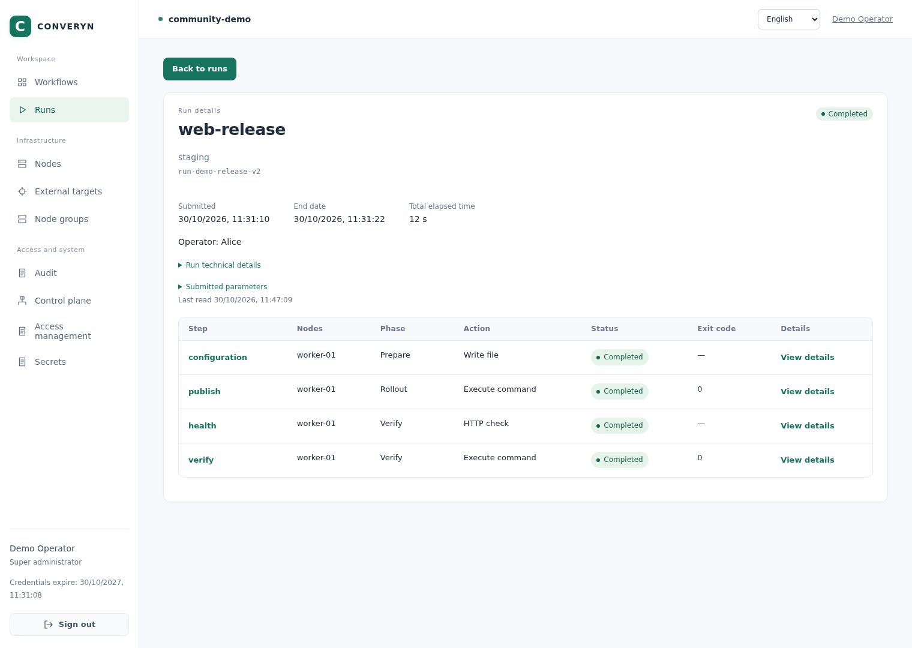

*A real local demo: configuration delivery → application release → HTTP health check → content verification. All four steps completed successfully.*

## What you can do

| Capability | What it provides |
| --- | --- |
| Deliver to hosts and Kubernetes | File and artifact delivery, exact-version packages, scripts, systemd services, HTTP checks, reboot and plugins; controller-side Kubernetes API access |
| Review before execution | Registered source snapshots, target presets, mutable and immutable values, typed parameters, and a dry-run plan with actual nodes and rendered operations |
| Coordinate releases | Ordered groups, batching, protected typed step outputs, versioned Secrets and explicit continuous reconciliation |
| Observe and recover | Per-step status, receipts, exit codes, logs, audit records and evidence for uncertain outcomes |
| Control access | Named identities, workflow and preset permissions, platform roles and node groups that bound Agent execution scope |
| Run a small control plane | One Rust binary with an embedded console; 1/3/5 controllers, mTLS, Raft and independent member SQLite, without an external database or message broker |

## See it in action

The screenshots use a disposable local environment with three controllers and one Agent. The host release was actually executed. Displayed identities, addresses, hardware identifiers and paths were replaced with public demo values before capture; tokens, private keys and Secret contents are excluded. CLI images render captured command output in a terminal layout. The screenshots demonstrate host delivery; runnable Kubernetes installation and CD examples are linked below.

<details>
<summary>Web console: configure, preview, inspect scripts and follow logs</summary>

Select a target preset and configure workflow values. Immutable values stay locked.

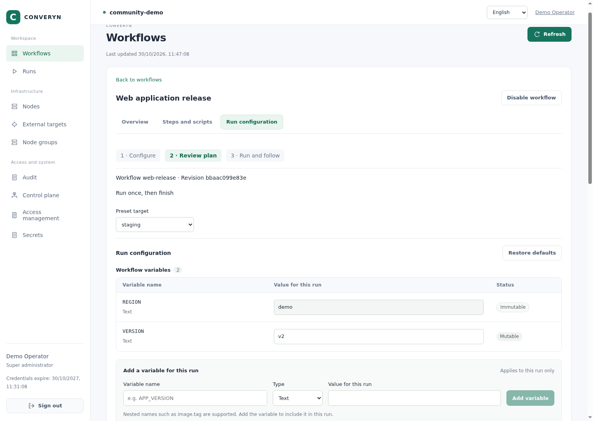

Review the resolved values, execution nodes and operations before submitting a Run.

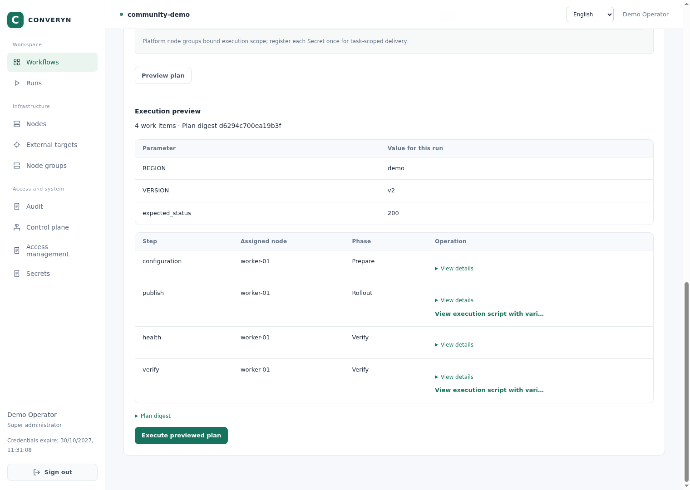

Inspect the registered script, its environment variable references and output emission.

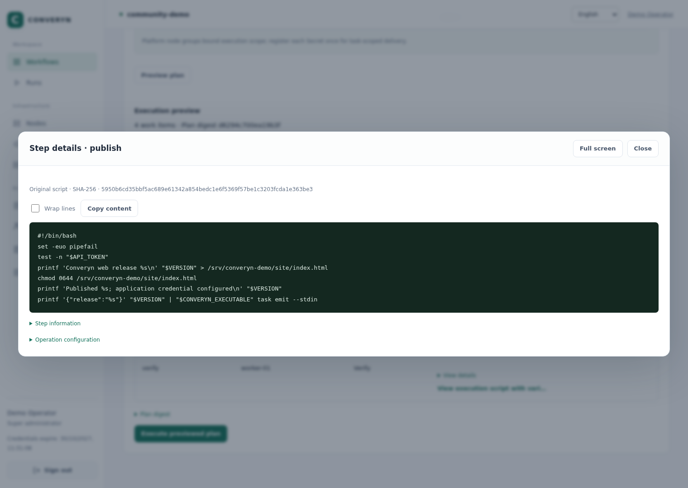

Open a step to inspect its result and application verification logs.

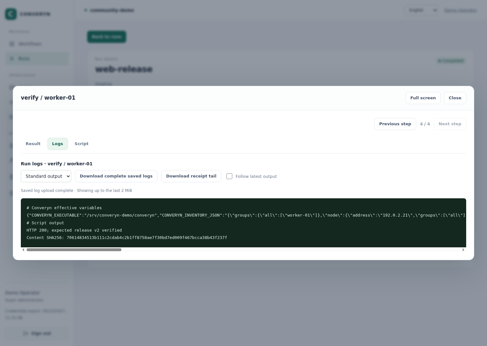

</details>

<details>
<summary>Web console: infrastructure, access, Secrets and audit</summary>

Inspect Agent connectivity, operating system, CPU, memory and host filesystem usage.

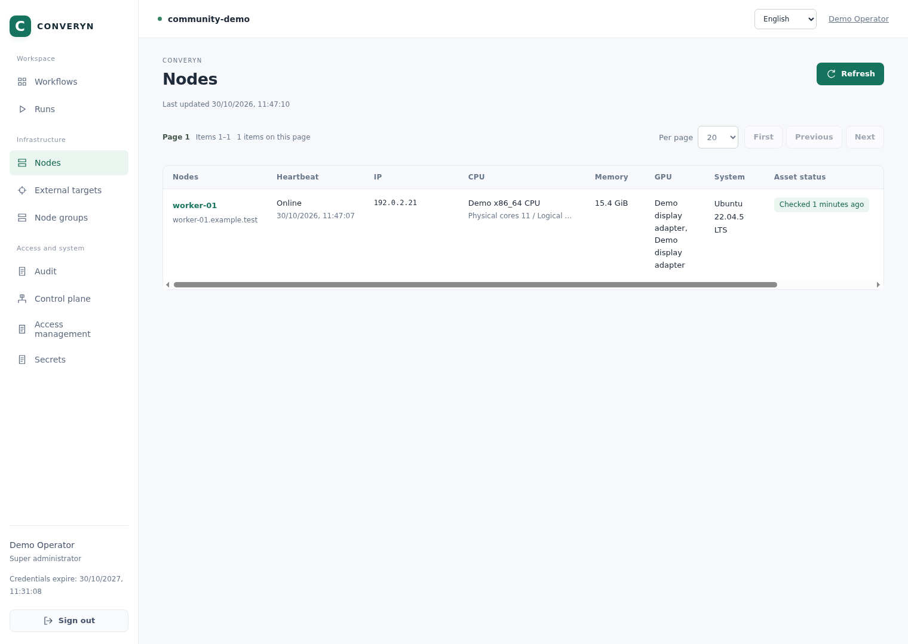

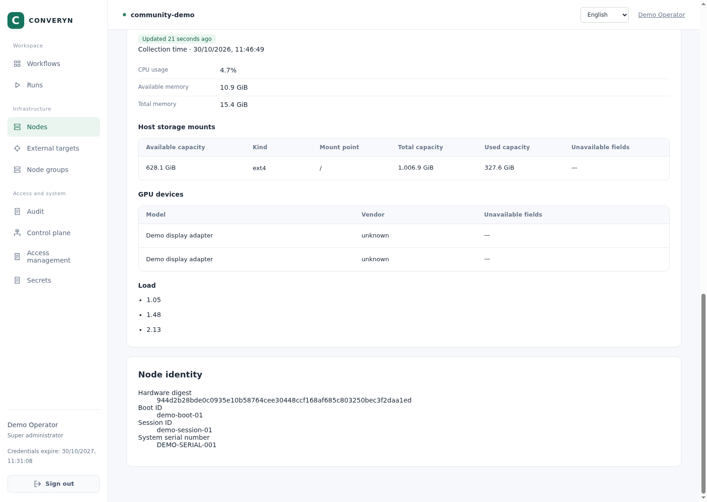

Grant permissions by person or group, role, workflow and preset. Alice can execute this release; Bob can view it.

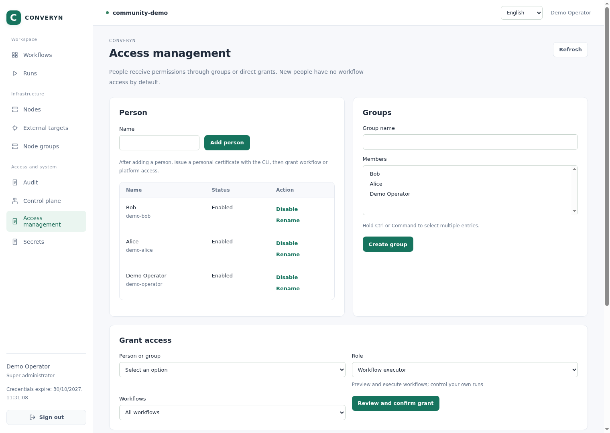

Manage named Secret versions without displaying their contents.

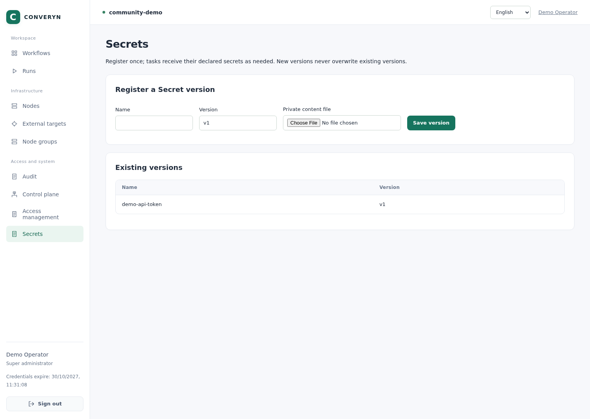

Review business operations separately from routine Agent observations.

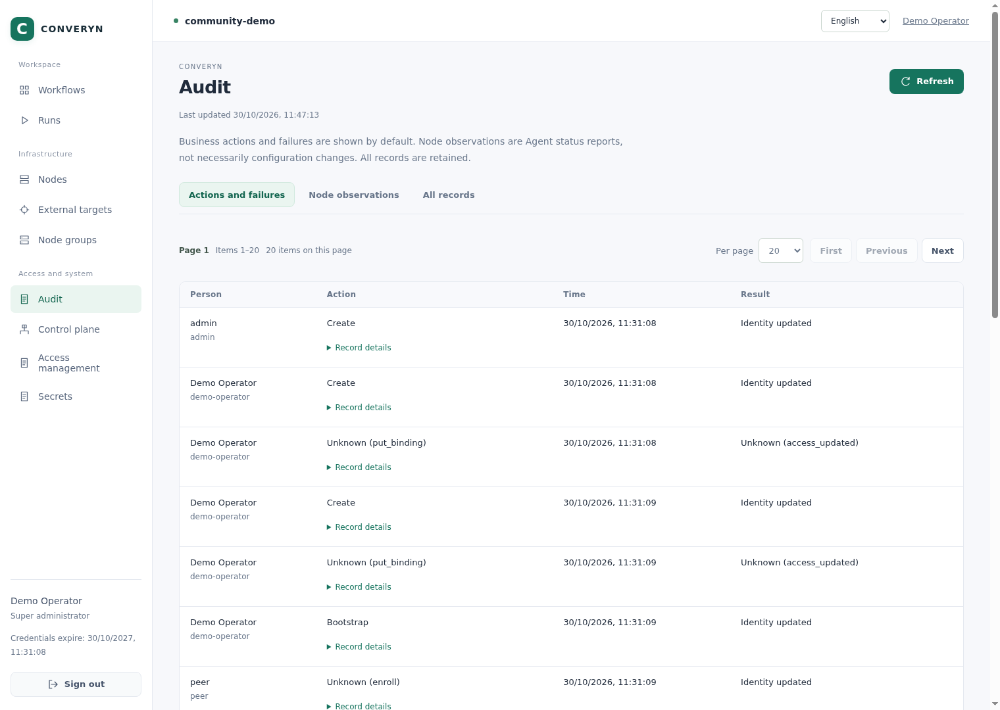

Inspect voting members and replication information in a three-controller demo.

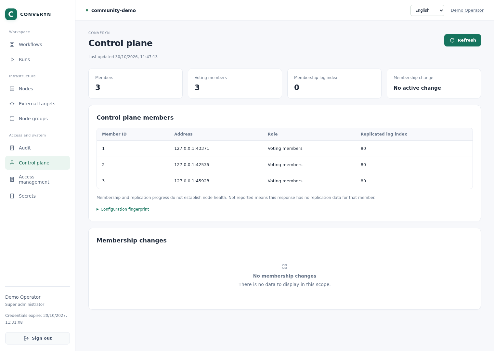

</details>

<details>
<summary>CLI: validate and preview → execute and wait → inspect logs and members</summary>

Validate and register a workflow, then inspect a dry-run plan. The JSON examples use `jq` to select fields; `jq` is optional and is not a Converyn runtime dependency.

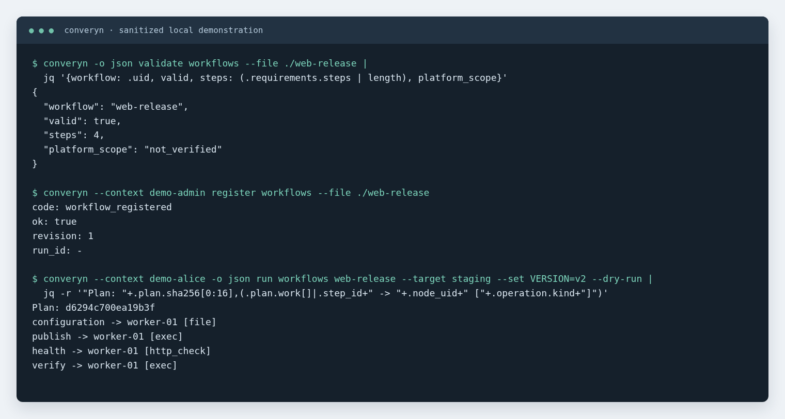

[Copyable command transcript](docs/assets/screenshots/shared/cli-plan.txt)

Submit a release with an explicit request ID and wait for its result.

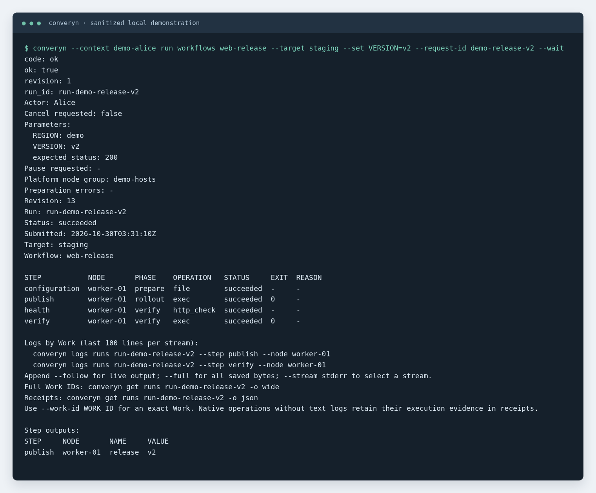

[Copyable command transcript](docs/assets/screenshots/shared/cli-run.txt)

Read verification logs, inspect control-plane membership and list local plugins.

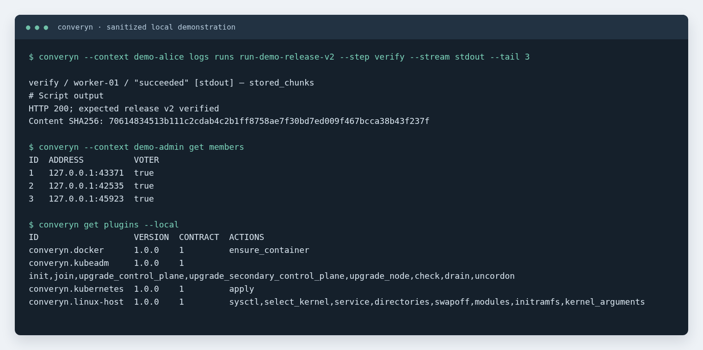

[Copyable command transcript](docs/assets/screenshots/shared/cli-observe.txt)

</details>

## Installation

Download the archive for your architecture from [GitHub Releases](https://github.com/LeeXN/converyn/releases), verify its `SHA256SUMS` entry and extract it. Each archive includes the binary, installation scripts and build manifest.

Use a reviewed static Linux amd64/arm64 release binary and keep both scripts together. Hosts need Linux, systemd and Bash 4.4+. Product runtime needs no Rust, Node.js, npm or Python; individual examples and development tools have their own dependencies.

```bash
bash ./install.sh --binary ./converyn-linux-amd64
bash ./init.sh --installation "$HOME/.local/share/converyn-install/qa"
```

[Installation tutorial](docs/en/tutorials/quickstart.md) · [Manual installation and networking](docs/en/how-to/installation.md)

## First Run

Prepare identities, Nodes and a platform node group using the tutorial, then run from the source checkout:

```bash
converyn validate workflows --file example/workflow
converyn --context qa-op register workflows --file example/workflow
converyn --context qa-alice run workflows demo --target qa --dry-run
converyn --context qa-alice run workflows demo --target qa --wait
converyn get runs
converyn logs runs RUN_ID --follow
```

Registration fixes the source snapshot. Register again after changing a workflow. Inspect the plan and verify the business result as well as the Run status.

## Runnable examples

| Example | What to explore |
| --- | --- |
| [Feature showcase](example/showcase/README.md) | Files, artifacts, packages, scripts, services, health checks, Secrets and outputs |
| [Full Kubernetes environment](example/kubernetes/README.md) | Community cluster installation, addons and ordered uninstall |
| [Linux continuous delivery](example/node-demo/README.md) | Release v1 → v2, verify the application, then return to v1 |
| [Kubernetes continuous delivery](example/external-kubernetes/README.md) | Connect an existing cluster and deploy a versioned application |
| [Continuous reconciliation](example/reconciliation/README.md) | Detect and repair file drift |
| [Host maintenance](example/maintenance/README.md) | Ordered reboot and recovery evidence |
| [CI integration templates](example/ci/README.md) | GitHub Actions, GitLab CI and Jenkins |

[All examples](example/README.md) · [Capability coverage](docs/en/reference/example-coverage.md)

## Documentation and contribution

[Documentation](docs/en/README.md) · [Web console guide](docs/en/how-to/web-console.md) · [CLI reference](docs/en/reference/cli.md) · [Architecture](docs/en/explanation/architecture.md) · [Release process](docs/en/development/releasing.md) · [Contributing](CONTRIBUTING.md) · [MIT License](LICENSE)
