# Converyn · 归衡

[English](README.md) | [简体中文](README.zh-CN.md)

Converyn 是 Rust 编写的声明式持续交付平台。登记流程、预览执行计划，再由 Agent 向 Linux 主机交付，或通过 API 向已有 Kubernetes 集群发布应用。CLI 与内嵌 Web 控制台共用权限、任务和审计。

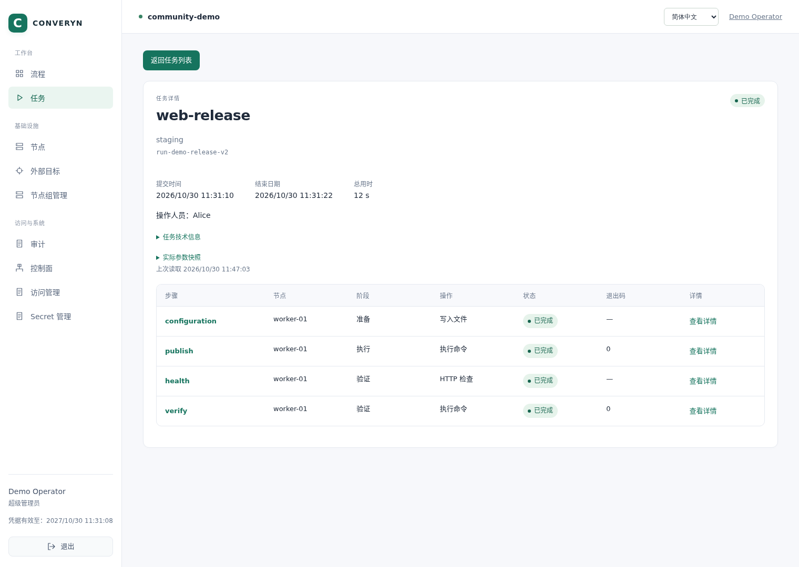

*本地真实演示：配置分发 → 应用发布 → HTTP 健康检查 → 内容验证，四个步骤均执行成功。*

## 核心能力

| 能力 | 提供什么 |
| --- | --- |
| 主机与 Kubernetes 交付 | 文件与制品分发、精确版本软件包、脚本、systemd 服务、HTTP 检查、重启与插件；控制器调用 Kubernetes API |
| 执行前预览 | 登记源码快照、目标预设、可变与不可变值、类型化参数，以及包含实际节点和渲染后操作的执行计划 |
| 发布编排 | 有序分组、分批执行、受保护的类型化步骤输出、版本化 Secret 与显式持续核对 |
| 观测与恢复 | 逐步状态、执行回执、退出码、日志、审计记录与不确定结果的处置依据 |
| 权限管理 | 具名身份、流程与预设权限、平台角色，以及限定 Agent 执行范围的平台节点组 |
| 精简控制面 | 单个 Rust 二进制内嵌控制台；支持 1/3/5 控制器、mTLS、Raft 和每成员独立 SQLite，无需外部数据库或消息队列 |

## 功能演示

截图来自一次性本地环境，包含三个控制器和一个 Agent，主机发布流程已实际执行。截图前已将身份、地址、硬件标识和路径替换为公开演示值，不包含令牌、私钥或 Secret 内容。CLI 图片将真实采集的命令输出排版为终端画面。截图展示主机发布路径，Kubernetes 安装与 CD 请见下方可运行示例。

<details>
<summary>Web 控制台：配置执行、预览计划、查看脚本与跟踪日志</summary>

选择目标预设并调整流程变量，不可变值保持锁定。

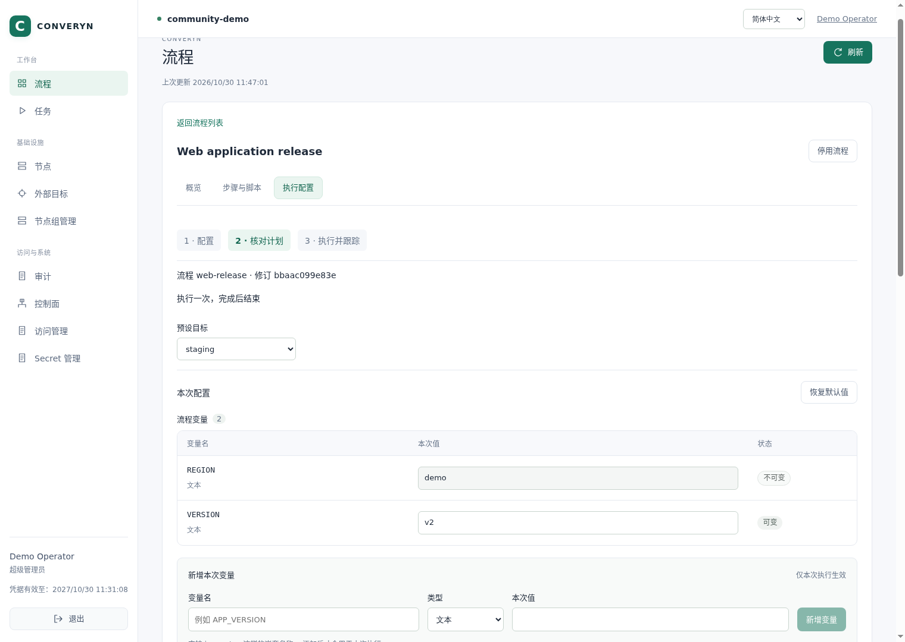

提交任务前，核对解析后的值、实际执行节点与操作内容。

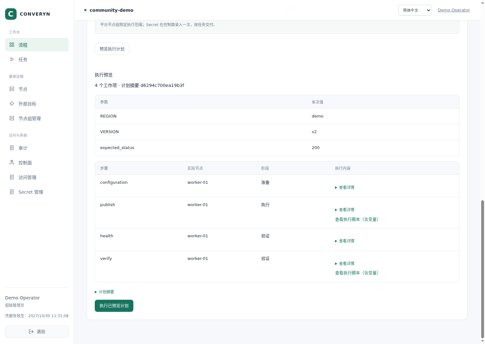

查看已登记的脚本、环境变量引用与输出上报。

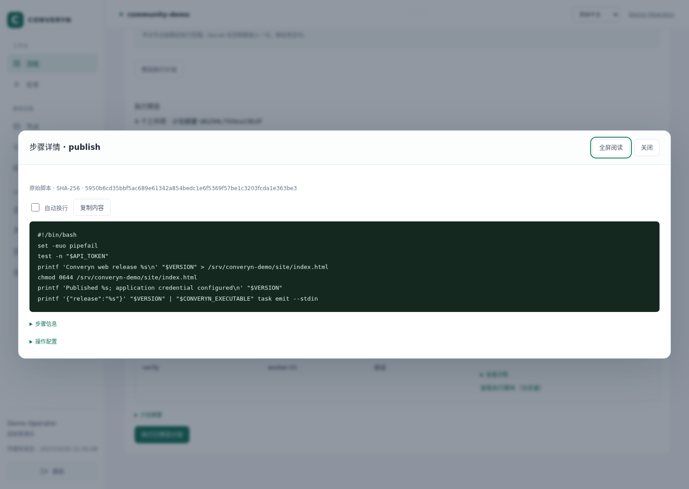

打开步骤，检查执行结果和应用验证日志。

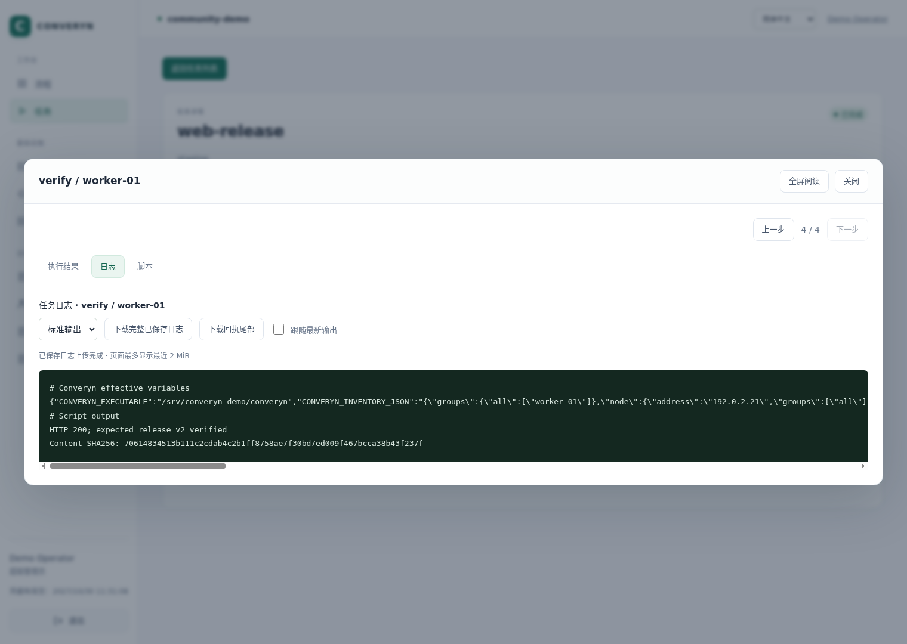

</details>

<details>
<summary>Web 控制台：基础设施、权限、Secret 与审计</summary>

查看 Agent 连通性、操作系统、CPU、内存与主机文件系统用量。

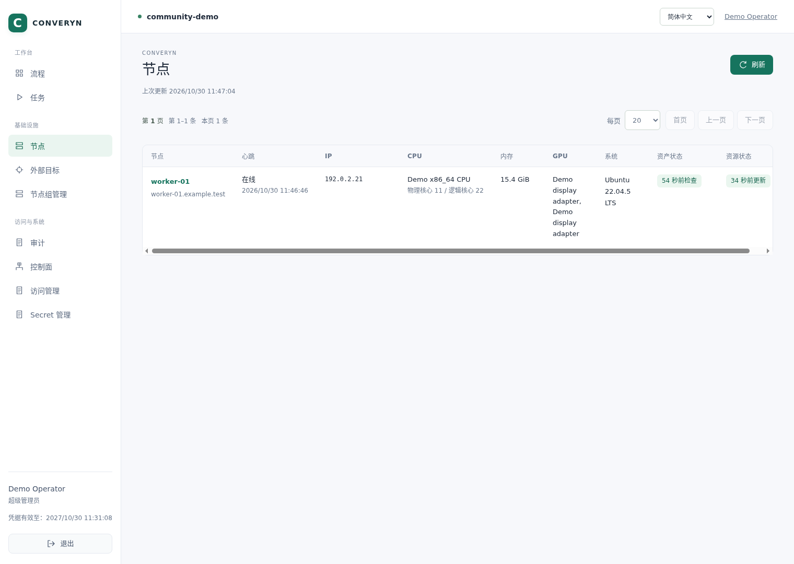

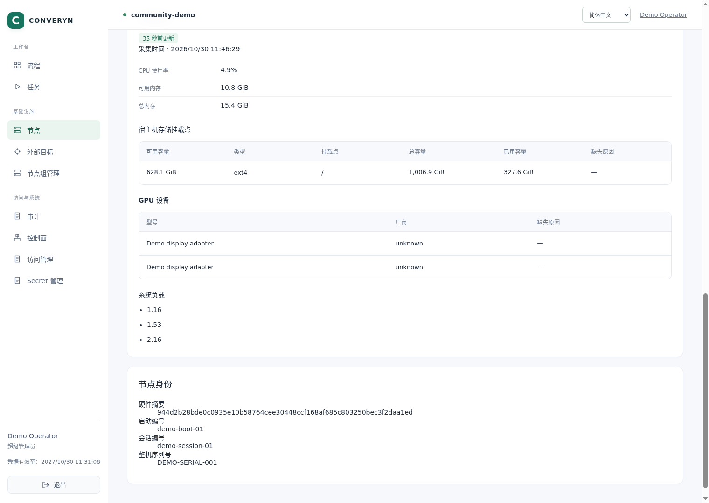

按人员或用户组、角色、流程和预设授权。Alice 可以执行本次发布，Bob 可以查看。

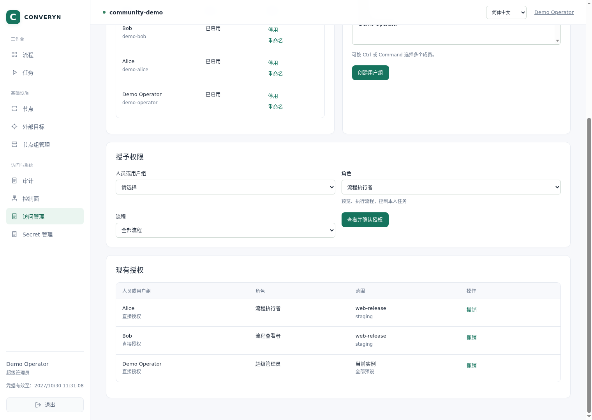

管理 Secret 名称和版本，页面不展示其内容。

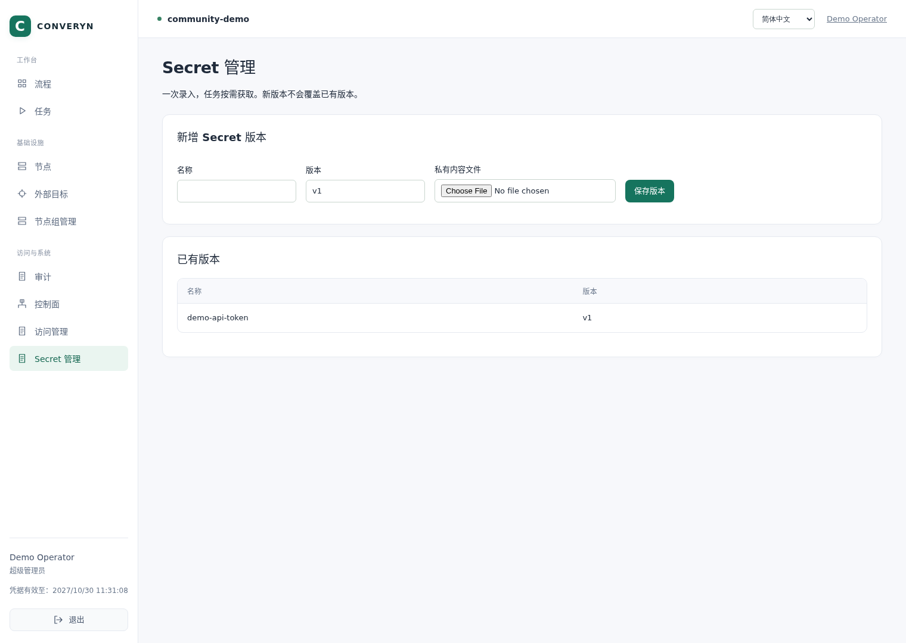

查看业务操作审计，并与 Agent 日常观测分开展示。

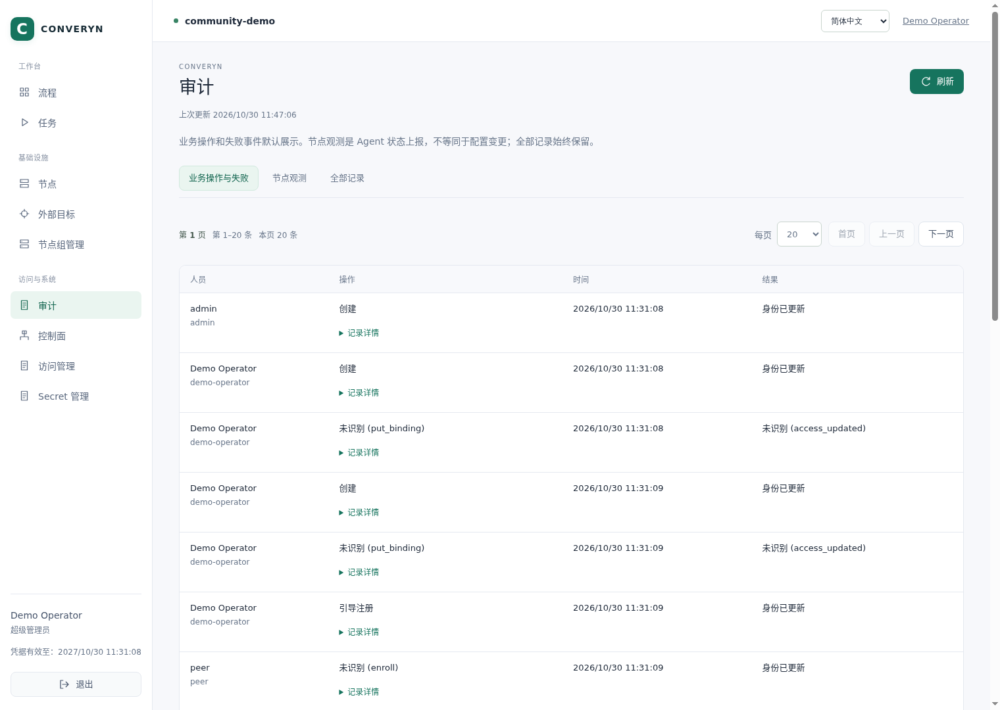

查看三个控制器的投票成员与复制信息。

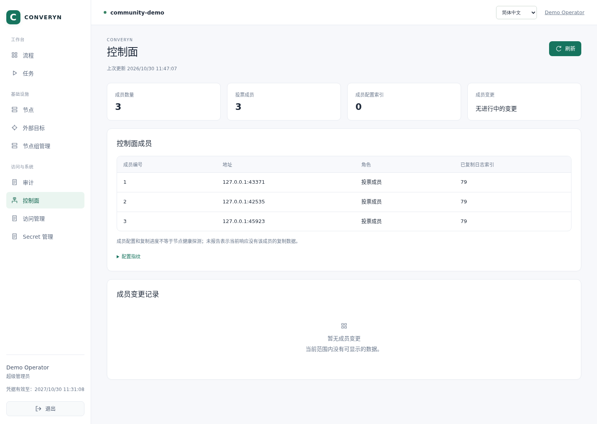

</details>

<details>
<summary>CLI：校验与预览 → 执行与等待 → 查看日志与成员</summary>

校验并登记流程，然后检查 dry-run 计划。JSON 示例使用 `jq` 选取字段；`jq` 是可选工具，不是 Converyn 的运行依赖。


[可复制的命令记录](docs/assets/screenshots/shared/cli-plan.txt)

使用明确的请求 ID 提交发布，等待执行结果。


[可复制的命令记录](docs/assets/screenshots/shared/cli-run.txt)

读取验证日志、查看控制面成员并列出本地插件。


[可复制的命令记录](docs/assets/screenshots/shared/cli-observe.txt)

</details>

## 安装

从 [GitHub Releases](https://github.com/LeeXN/converyn/releases) 下载对应架构的压缩包，核验 `SHA256SUMS` 中的对应校验值后解压。每个包都包含二进制、安装脚本与构建清单。

使用审核过的 Linux amd64/arm64 静态发行二进制，将两个脚本放在同一目录。目标主机需要 Linux、systemd 和 Bash 4.4+；产品运行无需 Rust、Node.js、npm 或 Python。某些示例和开发工具另有依赖。

```bash
bash ./install.sh --binary ./converyn-linux-amd64
bash ./init.sh --installation "$HOME/.local/share/converyn-install/qa"
```

[完整安装教程](docs/zh-CN/tutorials/quickstart.md) · [手工安装与网络](docs/zh-CN/how-to/installation.md)

## 首次执行

按教程准备身份、节点与平台节点组，再从源码仓库运行：

```bash
converyn validate workflows --file example/workflow
converyn --context qa-op register workflows --file example/workflow
converyn --context qa-alice run workflows demo --target qa --dry-run
converyn --context qa-alice run workflows demo --target qa --wait
converyn get runs
converyn logs runs RUN_ID --follow
```

登记会固定源码快照，修改流程后需要重新登记。执行前检查计划，完成后同时核验任务状态与业务结果。

## 可运行示例

| 示例 | 展示内容 |
| --- | --- |
| [功能综合展示](example/showcase/README.zh-CN.md) | 文件、制品、软件包、脚本、服务、健康检查、Secret 与输出 |
| [完整 Kubernetes 环境](example/kubernetes/README.zh-CN.md) | 社区集群安装、附加组件与有序卸载 |
| [Linux 持续交付](example/node-demo/README.zh-CN.md) | v1 → v2 发布、应用验证，再回到 v1 |
| [Kubernetes 持续交付](example/external-kubernetes/README.zh-CN.md) | 连接已有集群并发布版本化应用 |
| [持续核对](example/reconciliation/README.zh-CN.md) | 检测与修复文件漂移 |
| [主机维护](example/maintenance/README.zh-CN.md) | 有序重启与恢复依据 |
| [CI 集成模板](example/ci/README.zh-CN.md) | GitHub Actions、GitLab CI 与 Jenkins |

[全部示例](example/README.zh-CN.md) · [能力覆盖表](docs/zh-CN/reference/example-coverage.md)

## 文档与贡献

[文档](docs/zh-CN/README.md) · [Web 控制台指南](docs/zh-CN/how-to/web-console.md) · [CLI 参考](docs/zh-CN/reference/cli.md) · [架构](docs/zh-CN/explanation/architecture.md) · [发布流程](docs/zh-CN/development/releasing.md) · [贡献指南](CONTRIBUTING.zh-CN.md) · [MIT License](LICENSE)
