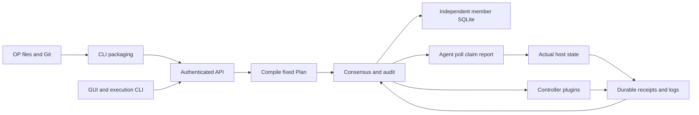

# Architecture and data flow

[English](architecture.md) | [简体中文](../../zh-CN/explanation/architecture.md)

One Rust binary supplies controller, Agent and CLI modes with an embedded React console. One, three or five controllers use OpenRaft and independent local SQLite stores, without an external database or message broker.

Public concepts are named identities, paired credentials, registered workflow revisions, preset targets and Runs. OP packages local files/Git checkouts through CLI. Users select an existing revision, preset and declared overrides. See [resources](../reference/resources.md).

The server and deterministic state machine validate identity, source, target and parameters. Pure plugin contracts are journaled before consensus; replay consumes the recorded results. Agents and controller plugins execute only after committed grants/fences, producing original receipts.

Workflow snapshots, public identity/credential records, plans, Runs and receipts are replicated. Managed artifact bytes are replicated on controller disks, while their immutable metadata uses Raft. Images are pulled from container registries. Raw logs use endpoint files and optional external storage; manifests and lifecycle evidence are replicated. Private keys, bearer tokens and resolved secrets remain in protected files/memory outside logical backups.

Business state and command audit commit in one SQLite transaction before publishing the committed view. Reads confirm quorum and follower forwarding preserves the original caller. Loss of quorum stops new grants. Agents retain intent/outbox/receipts across restart; unknown script outcomes require explicit resolution rather than replay.

Ordinary workflows execute once. Explicit reconciliation uses internal Deployment/Drift state and the successful execution snapshot; only reconcilable operations participate. System Runs retain original attribution. Future execution defaults remain those registered in the source.

Agent execution retains its OS identity and resource limits. Platform-approved workflows do not require per-node file, package, service, plugin or Secret allowlists. Registered workflow trust replaces per-script digest allowlists; digest checks still verify actual content. People have workflow-scoped viewer/executor/maintainer roles or instance-scoped platform_operator/access_admin/super_admin roles; Node/peer use separate protocol identities. Certificate/token pairing and deadlines are rechecked for requests and streams.

Storage schema and communication protocol are fixed by the release manifest. Mismatches reject startup or communication; follow the operations guide for upgrades and recovery.

## Execution and data flow

## Modules and design boundaries

| Module | Source | Responsibility |
| --- | --- | --- |
| CLI | [crates/cli/src](../../../crates/cli/src) | Configuration selection, source packaging, commands and readable output |
| Core | [crates/core/src](../../../crates/core/src) | Plan compilation, immutable snapshots and deterministic transitions without external I/O |
| Runtime | [crates/runtime/src](../../../crates/runtime/src) | HTTPS, Raft, SQLite, credentials, Agents, supervision and logs |
| Plugin API/plugins | [Contracts](../../../crates/plugin-api/src) · [Implementations](../../../plugins) | Pure validation/binding and endpoint execution; scenario logic stays outside the state machine |
| Web | [web/src](../../../web/src) | Same API and backend authorization as CLI |

Control-plane membership, business host groups and Kubernetes replicas are independent. Fixed 1/3/5-member HA uses independent SQLite. Agents pull work; SSH is not the execution transport. Deployment commands live in [installation](../how-to/installation.md).

Invariants: execution needs committed grants/fences; retries retain original intent; uncertain scripts retain evidence for resolution; cancellation never invents stop evidence; logical backups exclude private keys and raw logs; execution values cannot expand local capabilities. See [operations](../how-to/maintenance.md), [resources](../reference/resources.md) and the generated [API](../reference/api-reference.md).

Run outputs commit with the original receipt. Input materialization precedes authorization and preserves the original Plan. Secrets enter consensus as ciphertext and are delivered only under the original consumer grant, without secondary coordination state. See [step outputs](../how-to/outputs.md) for the contract and limits.
