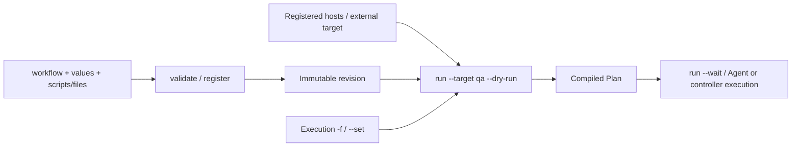

# Workflow and script authoring

[English](workflows.md) | [简体中文](../../zh-CN/how-to/workflows.md)

OP authors source files and registers immutable snapshots; executors select presets and execution values. Complete [installation](installation.md), then start from the [runnable minimal example](../../../example/workflow/README.md). Daily commands are in [usage](runs.md).

See [workflow directories](workflow-directories.md) for native packages, local labels and ordered groups.

## Know which files to write

A workflow needs just one source manifest, conventionally `workflow.yaml` (the name is arbitrary). Required top-level fields are `uid`, `name`, `targets`, and `playbook`; the Playbook needs `api_version`, `name`, and `steps`. Add source files when using scripts or managed text. You do not need to write a separate Plan.

| File/object | Required? | Contents and location |
| --- | --- | --- |
| `workflow.yaml` | Yes | Operator/Git: identity, presets, steps, and source mappings; input to `register workflows --file` |
| `values.yaml` | Optional | Ordinary business defaults; alternatively put an object directly in manifest `values` |
| `*.sh` | For `exec` | Packaged through `scripts: {STEP_ID: relative-path}`; executed on Agents |
| Text/application JSON | For `file` | Packaged through `files` as actual managed file bytes; `${VAR}` is not automatically substituted |
| `inventory.yaml` | Local host workflows | Enrolled Node UIDs, business addresses, hostnames and ordered groups |
| `target.json` | External API prerequisite | ExternalTarget, public identity, and local connection name; submitted with `update targets --file` |
| Personal `config.json` | Control-plane access | Private identity and Converyn contexts on the operator machine; unrelated to business values |
| Agent `agent.json` | Host prerequisite | Endpoint identity, permissions, Secrets, and artifact sources on each Node |
| Controller `server.json`, kubeconfig | External plugin prerequisite | Local service settings and credentials on controllers; never bundled into workflows |
| `PlanInput` file | Optional offline check | Concrete cluster snapshot and compilation inputs for `converyn compile plans --file` |
| `Plan` | Generated | Selected target, resolved values, Work, and digest; inspect with `run --dry-run` |



`playbook` defines steps inside a workflow; `PlanInput` is offline compiler input; `Plan` is compiled output. [offline PlanInput fixture](../../../scripts/tests/fixtures/plan.yaml) is a `PlanInput`, not registration input. The [Kubernetes preparation recipe](../../../example/kubernetes/stages.yaml) prepares fixed materials for its native workflow directory; follow that example's README.

Converyn `--context qa-op` selects a control plane and personal identity; `run --target qa` selects a registered workflow preset; a kubeconfig context selects an external Kubernetes connection. These names have no automatic relationship.

## Copy an example and complete a first run

Complete installation of `qa-op`, `qa-alice`, `node-a`, and the file policy first. From the repository root:

```bash
cp -R example/workflow /tmp/my-converyn-workflow
bash -n /tmp/my-converyn-workflow/verify.sh
converyn validate workflows --file /tmp/my-converyn-workflow/workflow.yaml
converyn --context qa-op register workflows --file /tmp/my-converyn-workflow/workflow.yaml
converyn --context qa-alice run workflows demo --target qa --dry-run
converyn --context qa-alice run workflows demo --target qa --wait
converyn get runs
```

The copy destination must not exist. Edit `inventory.yaml` with actual enrolled Node UIDs, addresses and hostnames. This workflow does not change a global host Cluster. Validation returns `valid: true` and a revision digest, checking local sources. After registration, `--dry-run` compiles against actual registered targets. Neither proves endpoint authorization or external API connectivity.

Use the returned Run ID with `get runs RUN_ID` and `logs runs RUN_ID --step verify --node node-a`, and inspect `/opt/converyn-demo/config` on the Node. Change `uid` to create another workflow. Re-register changes to scripts, steps, or defaults before running them.

## Files that form a workflow

```text
my-workflow/
├── workflow.yaml
├── inventory.yaml
├── values.yaml
├── config.txt
└── verify.sh
```

This manifest uses the local `inventory.yaml` and its enrolled `node-a` Node. `targets.qa` names a workflow preset, not a control-plane context.

```yaml
uid: demo
name: Demo workflow
inventory: inventory.yaml
targets:
  qa:
    hosts: all
files:
  configuration: config.txt
scripts:
  verify: verify.sh
values: values.yaml
immutable: [REGION]
node_values:
  node-a:
    PORT: 8081
playbook:
  api_version: converyn/v1
  name: demo
  steps:
    - id: configuration
      phase: rollout
      scope: per_node
      hosts: all
      operation:
        kind: file
        path: /opt/converyn-demo/config
        mode: 420
    - id: verify
      phase: verify
      scope: per_node
      hosts: all
      operation:
        kind: exec
        timeout_seconds: 30
```

Keys in `files`/`scripts` must match step IDs. Values are paths relative to the manifest directory; packaging computes digests and fills operation fields. Absolute paths, `..` and source-path symlinks are rejected. Individual sources are limited to 64 KiB and the source manifest to 1 MiB. Distribute binary artifacts separately. `mode: 420` is decimal 0644.

Phases advance through `prepare` → batched `rollout` → `verify`, with steps ordered as declared. This is not an arbitrary DAG; there is no `depends_on` field. Scopes are `per_node`, `once_per_run` and `once_per_batch`; rollout forbids `once_per_run`, and prepare/verify forbid `once_per_batch`. Select Nodes with roles, `node_uids` or labels; optionally constrain `max_parallel`. Preview the compiled Plan before execution. See [API types](../reference/api-types.md) for complete fields.

Prefer `file`, `binary`, `package`, `service`, `http_check` or plugins for observable desired state. Use Shell for operations without a native equivalent. Reconciliation requires explicit `reconcile_seconds`; arbitrary side-effecting Shell is not an automatically retryable declarative operation.

## How values reach scripts

`values.yaml` is an object, for example:

```yaml
VERSION: one
REGION: local
PORT: 8080
image:
  repository: example/application
  tag: stable
```

Precedence: workflow defaults → Node defaults → values files → `--set` → `--set-string`. `node_values` belongs to this workflow. `immutable: [REGION]` locks the region; dotted paths can lock nested fields such as `image.repository`. Objects merge recursively; arrays, scalars and null replace whole values. New ordinary execution variables are allowed, but cannot replace fixed environment, Secrets or reserved fields.

Scalars become same-named environment variables; objects/arrays become JSON strings. System-generated `WORKFLOW_VALUES_JSON` contains the complete Node-specific workflow values and cannot be user-defined. Top-level names must be valid environment names, excluding `CONVERYN_` and protected names such as `PATH`/`HOME`. Values enter the process environment; they are not substituted into script text or evaluated as Shell.

```bash
converyn run workflows demo --target qa --set image.tag=v2 --set-string VERSION=123 --dry-run
```

Repeated `--set` supports comma-separated assignments, escaped dots/commas, `ports[0]=80` and `names={one,two}`. Merged values are capped at 64 KiB/48 top-level keys; the final environment at 64 entries/128 KiB, subject to the total Plan limit.

Ordinary values appear in previews, task details and effective-environment log records. **Do not pass secrets with `--set PASSWORD=...`.** Use immutable references in the operation's `environment`:

```yaml
environment:
  API_TOKEN:
    secret: application-token
    version: v1
```

Prepare a private file on the operator machine and register it once with the control plane:

```bash
converyn --context qa-op register secrets application-token --version v1 --file /secure/application-token.txt
converyn --context qa-op get secrets application-token
```

Controllers encrypt and replicate the Secret. Only the assigned task with an active execution grant receives its declared plaintext inputs. CLI and console list names and versions without reading values back. Versions are immutable: register a new version and update workflow references to rotate. Keep the encryption keyring separately from database backups and use both for recovery. No per-node file distribution or Agent configuration is required.

## Ordinary values, fixed environment, and operation parameters

`values` provides ordinary script variables; `fixed` supplies author-controlled environment, including Secret references; `parameters` declares typed values bound to operation fields. Use parameters to expose service state, expected HTTP status, or Kubernetes replicas. `--set replicas=2` alone does not modify a Deployment.

For a workflow containing a `health` step, declare at the manifest top level:

```yaml
parameters:
  expected_status:
    kind: integer
    default: 200
    choices: [200, 204]
    bindings:
      - step_id: health
        path: /expected_status
```

The step must already contain `operation: {kind: http_check, url: "https://app.example.test/health", expected_status: 200, timeout_seconds: 10}`. Run `run FLOW --set expected_status=204 --dry-run` and inspect the compiled field. Binding paths are JSON Pointers relative to the operation, without an `/operation` prefix. Parameters also support `minimum`, `maximum`, and `max_length`; defaults must satisfy the declaration. See [external Kubernetes](external-kubernetes.md) for plugin bindings.

Application files do not read environment variables. Use `files` for fixed bytes; generate dynamic content explicitly in a constrained script or bind a file parameter to `/content` (restricted JSON edits support `allowed_json_paths` and `scalar_rules`). YAML is not a template language, and ordinary values do not implicitly modify native operation fields. See [API types](../reference/api-types.md).

| Common top-level field | Default/purpose |
| --- | --- |
| `batch_size` | 1; hosts per rollout batch |
| `download_parallel` | 16; artifact download concurrency limit |
| `reconcile_seconds` | Disabled; explicit 30–86400 seconds for reconcilable operations |
| `targets.NAME.owner_uid` | Optional stable owner, otherwise derived from workflow/preset; sharing requires an explicit common owner |
| `fixed` | Author-controlled environment, not execution overrides |
| `parameters` | Types, defaults, ranges, and operation field bindings |
| `values` / `node_values` / `immutable` | Ordinary defaults, per-Node differences, and locked paths |

Mixed workflows set `node_group_uid`, `hosts` and `external_target_uid`. Host selectors resolve only against the workflow inventory. A host `once_per_run` selects one Agent; controller plugins use their external execution route. See [scope and authorization](node-groups.md).

See [built-in operations](../reference/operations.md) for fields, permissions, and snippets, and [plugins](plugins.md) for generation and authorization.

## Script execution contract

Production Agents supervise as root. Ordinary scripts use the configured non-root UID/GID, normally `converyn-task`. Scripts execute with `/bin/bash`; a shebang does not change interpreters. Invoke an installed Python or other interpreter explicitly from Shell when needed. There is no interactive stdin and no inheritance of the operator's environment, login shell configuration or Git working directory.

The working directory and default `HOME` belong to this isolated Work, not the source directory. Scripts listed in the manifest are not automatically copied beside one another; `source ./common.sh` will not work by assumption. Combine shared content before registration or explicitly distribute it as digest-pinned artifacts/managed files.

```bash
#!/bin/bash
set -euo pipefail
: "${VERSION:?VERSION is required}"
: "${PORT:?PORT is required}"
[[ "$PORT" =~ ^[0-9]+$ ]] && (( PORT >= 1 && PORT <= 65535 )) || {
  printf 'Invalid PORT\n' >&2
  exit 2
}
test -s /opt/converyn-demo/config
printf 'Verified version=%s port=%s\n' "$VERSION" "$PORT"
```

- Quote values and avoid `eval` or building executable commands from variables. Parse structured values with a JSON parser.
- Return zero only on success; return nonzero and a useful stderr message on failure. Check real files, service health or API results; a success message alone proves little.
- Finish in the foreground. Do not deploy long-running processes with `nohup`, `&` or cgroup escape; use managed services.
- Set `timeout_seconds` from 1–86400 and bound external requests too. Timeouts/cancellation can leave partial effects, so retain inspectable evidence.
- Make repeat execution safe with state checks, stable business keys or atomic publication. Payments, notifications and append operations need external idempotency keys. Durable intents/receipts prevent blind replay; they do not promise global exactly-once external effects.

## Managed nodes and host steps

An enrolled node trusts workflows approved by its control plane. Existing personal roles govern workflow maintenance and execution; no per-node plugin, file, package, service or Secret allowlists are needed.

Shell defaults to `execution: user`, using an isolated unprivileged task account. Declare `execution: host` when a step needs to modify the host:

```yaml
operation:
  kind: exec
  execution: host
  script: install.sh
  timeout_seconds: 600
```

Host steps use root and the host filesystem, retaining systemd supervision, timeouts, resource limits, cancellation and receipts. Workflow maintenance therefore includes the ability to author host changes. Native files, packages, services, reboots and host plugins already declare host operations and need no additional grants. Reboots still require an explicit workflow request.

## Enable ongoing reconciliation

Ordinary workflows run once. To continuously maintain files, artifacts, services, or reconcilable plugins, add at manifest top level:

```yaml
reconcile_seconds: 60
```

Runs submitted after re-registration use that interval and their resolved parameter snapshot. Reconciliation preserves rollout batches and retains file, binary, service, http_check, and plugins declaring reconcilable. Host steps must be per_node; controller plugins may retain once_per_run. It does not replay exec, package, reboot, or host once-only hooks. Pause/cancel stops further repairs for that generation. Inspect linked Runs and receipts for failures/unknown outcomes instead of hiding them with shorter intervals.

## Validate, register and update

```bash
bash -n my-workflow/verify.sh
converyn validate workflows --file my-workflow/workflow.yaml
converyn --context qa-op register workflows --file my-workflow/workflow.yaml
converyn --context qa-alice run workflows demo --target qa --dry-run
converyn --context qa-alice run workflows demo --target qa --wait
```

Registration bundles files. The controller never reads operator paths, pulls Git or needs Git credentials. Git checkouts contribute commit/dirty provenance; review and commit source before registration. After changes, validate/register again for future executions. Identical snapshots do not create new revisions. Existing Runs retain their original snapshot.

Verify actual effects, non-root receipts, failure exits and logs on disposable targets before exposing a production workflow. For unknown outcomes, inspect the original Work using [usage](runs.md); never switch request IDs simply to rerun it.

For generated values and configuration updates between steps, see [output contracts](outputs.md) and the [runnable example](../../../example/outputs/README.md).

A successful reconciliation generation retains its submitted interval and inputs. Stop it with `cancel runs ORIGINAL_RUN_ID`, using the original Run that created that generation. Its successful receipt remains and currently authorized work may finish. Changing the source to `reconcile_seconds: null` affects future submissions, not existing generations; disabling the workflow is not a substitute for canceling the original Run.
