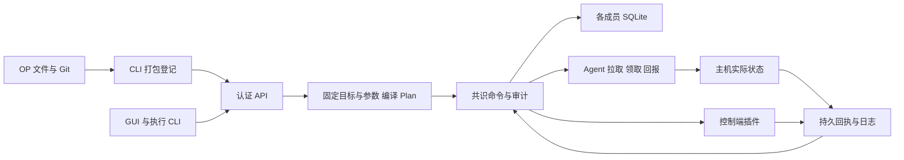

# 架构与数据流

[English](../../en/explanation/architecture.md) | [简体中文](architecture.md)

Converyn 是模块化单体：同一 Rust 二进制提供控制器、Agent 和 CLI，React 控制台内嵌分发。1/3/5 个控制器通过 OpenRaft 复制状态，每成员独立 SQLite，不依赖外部数据库或消息队列。

## 领域与执行

对外模型是具名身份、成套凭据、已登记流程、预设目标和 Run；详见[资源说明](../reference/resources.md)。OP 在本地或 Git 检出目录维护流程，CLI 打包登记不可变内容。执行者仅选择流程修订、目标预设和开放参数。

服务端和确定性状态机都检查流程、目标、参数及当前身份。插件纯契约通过 Journal 固定后复制，重放不调用当前插件实现。外部执行只在已提交 grant 和 fence 后发生。

## 存储与恢复

| 数据 | 存储 |
| --- | --- |
| 流程修订、人员与凭据公有记录、Plan、Run、授权和回执 | 控制器 SQLite，经 Raft 复制 |
| 大制品和镜像 | 托管制品字节在控制器磁盘复制；元数据经 Raft，镜像由容器仓库拉取 |
| 原始日志 | Agent 文件及可选集中后端；清单和生命周期证据复制 |
| 私钥、个人令牌明文、源凭据及解析后的 Secret | 受保护本地文件或内存，不进入逻辑备份 |

业务变化和命令审计在同一事务提交，提交后发布内存视图。读取确认多数派，Follower 保留原身份转发请求。丢失多数派停止新授权；已授权任务保留原 intent、outbox 和回执，网络恢复后回报。结果未知的脚本进入人工处置，不自动重跑。

## 持续核对与本机边界

普通流程执行一次。显式开启核对的流程使用内部 Deployment/Drift 状态，首次成功后核对已固定快照，只修复支持收敛的操作。系统任务记录原始提交人；下一次执行默认值仍取自流程定义。

Agent 执行控制面批准的流程，不再逐台配置文件、包、服务、插件或 Secret 白名单；执行账号、资源限制和可选外部制品源由平台配置。脚本摘要继续校验实际内容。

人员使用 viewer、executor、maintainer、platform_operator、access_admin、super_admin 角色；业务权限限定流程和预设，平台节点组限定主机目标范围。Node/peer 使用各自专用协议身份。证书令牌配对、撤销和截止时间在每次请求复核，流式读取持续复核。

存储 Schema 和通信协议由发行清单固定，不匹配时拒绝启动或通信。升级与恢复按运维指南执行。

## 模块与设计边界

| 模块 | 源码 | 责任 |
| --- | --- | --- |
| CLI | [crates/cli/src](../../../crates/cli/src) | 配置选择、源打包、命令与可读输出 |
| Core | [crates/core/src](../../../crates/core/src) | 编译 Plan、固定快照和确定性状态转换，无外部 I/O |
| Runtime | [crates/runtime/src](../../../crates/runtime/src) | HTTPS、Raft、SQLite、凭据、Agent、执行监督和日志 |
| Plugin API / 插件 | [契约](../../../crates/plugin-api/src) · [实现](../../../plugins) | 纯验证/绑定与端点执行能力，场景逻辑不塞入状态机 |
| Web | [web/src](../../../web/src) | 通过同一 API 操作，后端权限不依赖页面隐藏 |

控制面成员数、业务节点组和 Kubernetes 副本数相互独立。固定 1/3/5 成员拓扑，HA 不共享 SQLite；节点从控制面拉取任务，不把 SSH 当常规执行通道。部署命令统一见[安装](../how-to/installation.md)。

关键不变量：无已提交 grant/fence 不执行；网络重试复用原意图；未知脚本结果保留证据等待核实；取消不伪造已停止；逻辑备份不包含私钥和原始日志；本机能力不能由执行参数扩权。运维操作见[运维](../how-to/maintenance.md)，对象语义见[资源模型](../reference/resources.md)，HTTP 字段以[生成的 API](../reference/api-reference.md)为准。

Run 输出与原回执一起提交；输入先物化再授权，原 Plan 不变。敏感值以密文进入共识，只通过原消费授权交付，不增加第二套协调状态。契约和限制见[步骤输出](../how-to/outputs.md)。
