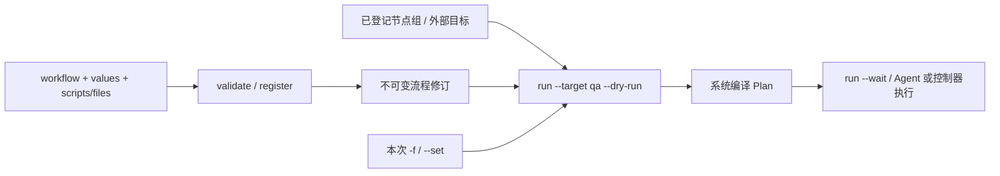

# 流程与脚本编写指南

[English](../../en/how-to/workflows.md) | [简体中文](workflows.md)

OP 编写源文件并登记快照，执行者选择目标与本次变量。先完成[安装](installation.md)，从[可运行的最小示例](../../../example/workflow/README.zh-CN.md)开始；日常命令见[使用指南](runs.md)。

原生流程目录、独立标签及有序分组见[流程目录接口](workflow-directories.md)。

## 先分清要写的文件

最少只需一个流程源文件（通常叫 `workflow.yaml`，文件名可自定）。必填顶层字段是 `uid`、`name`、`targets`、`playbook`；`playbook` 必须有 `api_version`、`name`、`steps`。使用 Shell 或文本文件时，再准备对应的源文件。无需额外手写 Plan。

| 文件/对象 | 是否必备 | 写什么、放哪里 |
| --- | --- | --- |
| `workflow.yaml` | 必备 | 操作机/Git：流程标识、目标预设、步骤和源文件映射；`register workflows --file` 的入口 |
| `values.yaml` | 可选 | 普通业务默认值；也可把对象直接写在流程的 `values` 中 |
| `*.sh` | 有 `exec` 时需要 | 通过 `scripts: {步骤ID: 相对路径}` 打包，内容在 Agent 上执行 |
| `config.txt`、业务 JSON 等 | 有 `file` 时需要 | 通过 `files` 打包，作为目标主机文件的实际内容；不会自动替换 `${VAR}` |
| `inventory.yaml` | 本地节点流程 | 已登记 Node UID、业务地址、主机名及有序分组 |
| `target.json` | 外部 API 流程的前置登记 | ExternalTarget、公开身份及本地连接名；由 `update targets --file` 提交 |
| 个人 `config.json` | 访问控制面的前提 | 私有身份和 Converyn context，操作机保存；与业务参数文件无关 |
| Agent `agent.json` | 主机执行前提 | 节点身份、本机权限、Secret 和制品源，保存在执行节点 |
| 控制器 `server.json`、kubeconfig | 外部插件执行前提 | 控制器本机服务配置与外部系统凭据，不打包到流程 |
| `PlanInput` 文件 | 仅离线检查可选 | 含具体 cluster 快照的编译输入，交给 `converyn compile plans --file` |
| `Plan` | 系统生成 | 已选目标、最终参数、Work 和摘要；通过 `run --dry-run` 查看，无需自行维护 |



`playbook` 是流程中的步骤定义；`PlanInput` 是离线编译器的输入；`Plan` 是编译结果。仓库 [offline PlanInput fixture](../../../scripts/tests/fixtures/plan.yaml) 属于 `PlanInput`，不能直接拿它当 `register workflows` 的输入。[Kubernetes 准备配方](../../../example/kubernetes/stages.yaml)用于准备原生流程目录的固定材料，使用方式见其 README。

Converyn 的 `--context qa-op` 选择控制面和个人身份，`run --target qa` 选择流程内的目标预设，kubeconfig 的 context 选择外部 Kubernetes 连接。三个名字分别定义，没有自动关联。

## 从复制示例到第一次成功

先完成安装指南的 `qa-op`、`qa-alice`、`node-a` 和文件策略。在仓库根目录执行以下命令；只需已有工具和示例文件：

```bash
cp -R example/workflow /tmp/my-converyn-workflow
bash -n /tmp/my-converyn-workflow/verify.sh
converyn validate workflows --file /tmp/my-converyn-workflow/workflow.yaml
converyn --context qa-op register workflows --file /tmp/my-converyn-workflow/workflow.yaml
converyn --context qa-alice run workflows demo --target qa --dry-run
converyn --context qa-alice run workflows demo --target qa --wait
converyn get runs
```

复制目的目录应尚不存在。在 `inventory.yaml` 填写实际已登记 Node UID、地址和主机名。本流程不修改全局主机 Cluster。`validate` 成功会返回 `valid: true` 和修订摘要；它检查本地源内容。登记后 `--dry-run` 才结合控制面的实际目标编译计划；两者都不验证真实节点权限或外部 API 可达性。

成功后用返回的 Run ID 查看 `get runs RUN_ID` 和 `logs runs RUN_ID --step verify --node node-a`，并在节点核对 `/opt/converyn-demo/config`。修改 `uid` 可以创建另一个流程；修改已有流程的脚本、步骤或默认值后重新登记，再运行才生效。

## 文件如何组成流程

```text
my-workflow/
├── workflow.yaml
├── inventory.yaml
├── values.yaml
├── config.txt
└── verify.sh
```

以下使用本地 `inventory.yaml` 及其中已登记的 `node-a` 节点；`targets.qa` 是本流程的目标预设名称，不是控制面 context。

```yaml
uid: demo
name: Demo workflow
inventory: inventory.yaml
targets:
  qa:
    hosts: all
files:
  configuration: config.txt
scripts:
  verify: verify.sh
values: values.yaml
immutable: [REGION]
node_values:
  node-a:
    PORT: 8081
playbook:
  api_version: converyn/v1
  name: demo
  steps:
    - id: configuration
      phase: rollout
      scope: per_node
      hosts: all
      operation:
        kind: file
        path: /opt/converyn-demo/config
        mode: 420
    - id: verify
      phase: verify
      scope: per_node
      hosts: all
      operation:
        kind: exec
        timeout_seconds: 30
```

`files`、`scripts` 的键必须对应步骤 `id`，值是流程文件所在目录内的相对路径；打包器计算内容摘要并补充操作字段。拒绝绝对路径、`..` 和源文件路径中的符号链接。单个源文件最多 64 KiB，源清单最多 1 MiB；不要把二进制制品作为内联脚本打包。`mode: 420` 是十进制的 0644。

阶段按 `prepare` → 分批 `rollout` → `verify` 推进，步骤按定义顺序编排；不是任意 DAG，没有 `depends_on` 字段。`per_node` 对选中节点执行，`once_per_run` 每次一次，`once_per_batch` 每批一次；rollout 不允许 `once_per_run`，prepare/verify 不允许 `once_per_batch`。用 `roles`、`node_uids` 或标签约束节点，必要时设置 `max_parallel`。预览最终 Plan 后再登记执行。完整字段见 [API 类型](../reference/api-types.md)。

优先使用 `file`、`binary`、`package`、`service`、`http_check` 或插件描述可观察的目标状态；Shell 适合缺少原生操作的步骤。持续核对仅在显式设置 `reconcile_seconds` 后启用，不能把任意有副作用的 Shell 当作可自动重试的声明式操作。

## 变量如何到达脚本

`values.yaml` 是对象，例如：

```yaml
VERSION: one
REGION: local
PORT: 8080
image:
  repository: example/application
  tag: stable
```

优先级为流程默认值 → 节点默认值 → `-f` 文件 → `--set` → `--set-string`。`node_values` 只影响本流程；`immutable: [REGION]` 锁定区域，也可锁定 `image.repository` 等嵌套路径。对象递归合并，数组、标量与 null 整体替换。运行时可增加普通变量，不能覆盖固定环境、Secret 或保留字段。

标量作为同名进程环境变量；对象和数组作为 JSON 字符串。`WORKFLOW_VALUES_JSON` 包含当前节点的完整流程变量对象，由系统生成，不能自定义。顶层变量使用合法环境变量名，不能使用 `CONVERYN_` 前缀或 `PATH`、`HOME` 等受保护名称。变量通过进程环境传递，不替换脚本文本，不执行 Shell 求值。

```bash
converyn run workflows demo --target qa --set image.tag=v2 --set-string VERSION=123 --dry-run
```

重复 `--set` 支持逗号分隔、转义点号/逗号、`ports[0]=80` 和 `names={one,two}`。合并值最多 64 KiB、48 个顶层键；最终环境最多 64 项、128 KiB，并受 Plan 总大小限制。

普通变量会出现在预览、任务详情及日志的有效环境记录中，**不要用 `--set PASSWORD=...` 传秘密**。秘密使用操作 `environment` 中的不可变引用，例如：

```yaml
environment:
  API_TOKEN:
    secret: application-token
    version: v1
```

在操作机准备私有文件，然后向控制面录入一次，所有任务按引用自动获取：

```bash
converyn --context qa-op register secrets application-token --version v1 --file /secure/application-token.txt
converyn --context qa-op get secrets application-token
```

控制器加密保存并复制 Secret；只向持有有效执行许可的目标任务交付明文。CLI 和网页只查看名称、版本，不回读内容。版本不可覆盖，轮换时登记新版本并更新流程引用。密钥环与数据库备份须分别保留，恢复时同时使用。无需向节点复制文件或修改 Agent 配置。

## 普通变量、固定值与操作参数

`values` 是传给脚本的业务变量，`fixed` 是流程作者固定的环境（包括 Secret 引用），`parameters` 声明有类型约束且绑定到某个操作字段的可改参数。想让用户修改服务状态、HTTP 检查期望值或 Kubernetes 副本数，需要 `parameters`；只写 `--set replicas=2` 不会自动修改 Deployment。

例如在包含 `health` 步骤的流程顶层声明：

```yaml
parameters:
  expected_status:
    kind: integer
    default: 200
    choices: [200, 204]
    bindings:
      - step_id: health
        path: /expected_status
```

对应步骤必须已经有 `operation: {kind: http_check, url: "https://app.example.test/health", expected_status: 200, timeout_seconds: 10}`。执行 `run FLOW --set expected_status=204 --dry-run`，在 Plan 中核对该字段。`path` 是相对于 operation 的 JSON Pointer，不带 `/operation` 前缀。参数也可设置 `minimum`、`maximum`、`max_length`；默认值必须符合声明。插件路径示例见[外部 Kubernetes](external-kubernetes.md)。

业务配置文件不会读取环境变量。固定文本用 `files`；动态内容可在受限脚本中明确生成，或通过 `parameters` 绑定 file 的 `/content`（受限 JSON 修改可用 `allowed_json_paths` 和 `scalar_rules`）。不要把 YAML 当模板语言，也不要假定 `values` 会修改任何原生操作字段。字段契约见 [API 类型](../reference/api-types.md)。

流程常用顶层选项：

| 字段 | 默认/作用 |
| --- | --- |
| `batch_size` | 默认 1，每批主机数；分批只影响 rollout |
| `download_parallel` | 默认 16，制品下载并发限制 |
| `reconcile_seconds` | 默认不启用；显式值 30–86400 秒，仅用于可收敛操作 |
| `targets.NAME.owner_uid` | 可省略；系统按流程/预设生成稳定所有者；共享资源需显式统一所有者 |
| `fixed` | 固定环境，不接受执行者覆盖 |
| `parameters` | 类型、默认值、范围和到操作字段的绑定 |
| `values` / `node_values` / `immutable` | 普通默认值、流程内节点差异、不可覆盖路径 |

混合流程同时声明 `node_group_uid`、`hosts` 和 `external_target_uid`。主机选择器只解析本流程 inventory；主机 `once_per_run` 选择一个 Agent，控制器插件走独立外部执行路由。见[范围与授权](node-groups.md)。

内置操作的字段、前置权限和最小片段见[内置功能参考](../reference/operations.md)；插件的生成与授权见[插件指南](plugins.md)。

## 脚本执行约定

生产 Agent 是 root 监督器，普通脚本使用配置中的低权限 UID/GID，标准安装为 `converyn-task`。脚本由 `/bin/bash` 执行；shebang 不会切换解释器，要使用 Python 等语言时在 Shell 内显式调用已安装解释器。它没有交互 stdin，不读取操作机的环境、登录 shell 配置或 Git 工作目录。

工作目录是本次 Work 的隔离目录，`HOME` 默认也在该目录；不是流程源目录。`scripts` 中的脚本彼此不会自动复制为相邻文件，不能假定 `source ./common.sh` 可用。将共享内容合并进登记的脚本，或通过固定摘要的制品/受管文件显式分发。

```bash
#!/bin/bash
set -euo pipefail
: "${VERSION:?VERSION is required}"
: "${PORT:?PORT is required}"
[[ "$PORT" =~ ^[0-9]+$ ]] && (( PORT >= 1 && PORT <= 65535 )) || {
  printf 'Invalid PORT\n' >&2
  exit 2
}
test -s /opt/converyn-demo/config
printf 'Verified version=%s port=%s\n' "$VERSION" "$PORT"
```

- 始终引用变量，如 `"$VERSION"`，不要 `eval` 或将变量拼成待执行命令。对象参数用 JSON 解析器读取。
- 成功返回 0，失败返回非零并向 stderr 写清原因。业务成功还应检查实际文件、服务健康或 API 结果；只打印“成功”不能替代验证。
- 在前台完成，不能用 `nohup`、`&` 或自行脱离 cgroup 来部署长期进程；长期进程交给受管服务。
- 设置合理的 `timeout_seconds`（1–86400），外部请求也设置自身超时。超时与取消可能留下部分变更，应保留可检查的证据。
- 重复执行应检查现有状态、使用稳定业务键或原子替换；发款、发通知、追加数据等副作用需外部幂等键。平台保留原 intent/回执并避免盲重放，不承诺外部副作用的全局 exactly-once。

## 托管节点与主机步骤

节点加入后信任控制面批准的流程。现有人员角色控制谁能维护、执行流程，不再逐台配置插件、文件、包、服务或 Secret 白名单。

Shell 默认 `execution: user`，以隔离的低权限账户运行，只需工作目录即可完成的任务使用默认值。需要修改主机的步骤声明 `execution: host`：

```yaml
operation:
  kind: exec
  execution: host
  script: install.sh
  timeout_seconds: 600
```

主机步骤使用 root 和主机文件系统，保留 systemd 监督、超时、资源限制、取消和回执。它能修改主机，流程维护权限也意味着可以编写主机操作。文件、包、服务、重启和主机插件本身就是明确的主机操作，不需要额外授权。重启仍须由流程明确请求。

## 持续核对如何开启

普通流程只执行一次。需要持续保持文件、制品、服务或可收敛插件状态时，在流程顶层增加：

```yaml
reconcile_seconds: 60
```

重新登记后提交的 Run 使用该周期与本次最终参数快照。系统保留 rollout 分批，核对并修复 file、binary、service、http_check 及声明 reconcilable 的插件；主机步骤仅保留 per_node，控制器插件可保留 once_per_run。不会自动重跑 exec、package、reboot 或主机一次性钩子。暂停/取消原任务停止该代次继续修复；核对失败或未知结果先查关联 Run 和回执，不通过缩短周期掩盖失败。

## 校验、登记与更新

```bash
bash -n my-workflow/verify.sh
converyn validate workflows --file my-workflow/workflow.yaml
converyn --context qa-op register workflows --file my-workflow/workflow.yaml
converyn --context qa-alice run workflows demo --target qa --dry-run
converyn --context qa-alice run workflows demo --target qa --wait
```

登记时打包源文件，控制器不读取操作机路径、不拉取 Git、不需要 Git 凭据。Git 检出目录会记录提交与 dirty 来源信息；建议先审查并提交源文件。修改脚本或默认值后重新 validate/register 才影响后续执行；相同快照重复登记不创建新修订。已有 Run 仍引用原快照。

在可丢弃目标上验证实际结果、非 root 回执、失败退出与日志，再开放正式流程。结果未知时按[使用指南](runs.md)查询并核实原 Work，不能换请求 ID 直接重跑。

步骤间生成值和配置回写见[输出契约](outputs.md)及[可运行示例](../../../example/outputs/README.zh-CN.md)。

已成功运行的核对代次保留提交时的周期和输入。停止它时使用 `cancel runs ORIGINAL_RUN_ID`，指定创建该代次的原始 Run；原成功回执保留，当前已授权的工作可能完成。修改流程定义为 `reconcile_seconds: null` 只影响未来提交，不停止已有代次；停用流程也不代替取消原始 Run。
