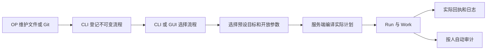

# 资源与操作模型

[English](../../en/reference/resources.md) | [简体中文](resources.md)

Converyn 使用平台权限与流程授权。新人员默认无业务权限，角色绑定可限定流程和预设；执行者控制本人任务，维护者控制范围内全部任务。CLI、GUI 与 API 统一校验，详见[人员与流程授权](../how-to/access.md)。

## 资源职责

| 资源 | 作用 | 谁维护 |
| --- | --- | --- |
| Identity | 稳定人员 ID、显示名称、管理员或执行者权限、启停状态 | OP 通过 CLI |
| Credential | 个人证书指纹与配套令牌摘要、生效/到期时间、撤销和重叠截止时间 | OP 通过 CLI |
| Workflow | 流程标识、当前不可变修订和启停状态 | OP 从文件或 Git 检出目录登记 |
| WorkflowRevision | Playbook、脚本与文本定义、固定配置、参数声明、目标预设、来源和核对策略的快照 | 登记时生成 |
| TargetPreset | 流程允许的主机 Cluster 或外部目标；混合流程可同时绑定两者 | 流程文件 |
| Cluster / Node | 带修订的业务主机组与节点角色、标签、变量；节点另有登记身份与心跳观察 | OP 登记，Agent 上报 |
| ExternalTarget | 控制端插件访问的外部系统、固定身份和本地连接引用 | OP 登记 |
| Plan / Work | 服务端将目标快照和最终参数展开后的计划及单执行位置操作 | 系统编译 |
| Run / Attempt | 一次执行，以及每个 Work 的授权、会话、进度与结果 | 系统执行 |
| Receipt / 日志 Manifest | 实际操作证据、退出码、原生观察、日志摘要及完整性信息 | 执行端产生 |
| Deployment / Drift Policy | 显式开启持续核对的长期状态及周期；普通一次性流程不需要 | 系统内部 |
| Audit / History | 人员操作审计、执行与归档证据 | 自动保存 |

## 目标预设、主机集群与外部目标

| 概念 | 回答的问题 | 示例 |
| --- | --- | --- |
| 目标预设（TargetPreset） | 这次流程选择哪套执行位置？ | 测试、生产；由流程文件固定主机集群或外部目标 |
| 主机集群（Cluster） | 哪些主机可由 Agent 执行操作？ | hosts，包含节点及其角色、标签 |
| 外部目标（ExternalTarget） | 控制器要通过 API 操作哪个已有的平台？ | 具有固定集群、命名空间身份和连接引用的 Kubernetes 目标 |

在主机上部署时，选择绑定主机集群的流程预设，由 Agent 写文件、管理服务或运行脚本。向已有 Kubernetes 集群发布应用时，选择绑定外部目标的预设，由控制器调用 API 更新 Deployment 并检查状态。混合流程可以同时使用主机与外部平台。

运维人员维护平台连接、访问凭据和目标登记；执行人员选择已有预设、预览并执行。外部目标页面展示登记信息，流程详情展示本次选择的绑定，预览展示实际步骤和执行位置。完整使用说明见[Web 控制台](../how-to/web-console.md)，连接与插件约束见[插件](../how-to/plugins.md)。

控制面成员是运行 Converyn 共识与调度的服务器，由“控制面”页面查看。

## 配置边界

Playbook、脚本、长期默认值和可修改字段声明都在服务器文件或 GitHub/GitLab 中维护。平台不编辑它们，也不保存本次覆盖为新默认值。

最终执行配置由固定配置、已声明参数的默认值及本次覆盖组成。参数可绑定指定步骤的脚本环境变量、原生操作或插件业务字段。类型/范围错误、目标、脚本入口、执行 profile、插件身份和凭据引用的覆盖也被拒绝。流程可通过 `-f`、`--set` 和 GUI 新增本次变量，`immutable` 在服务端限制覆盖，`node_values` 提供流程内节点差异。详见[流程变量示例](../../../example/workflow/README.zh-CN.md)。秘密值使用固定版本 Secret 引用。

OP 更新目录后执行 register workflows。控制器登记完整内容快照，而不是每次运行时读取最新文件或 Git 分支。登记失败保留当前修订；旧 Run 永远保留原始输入。重复登记相同内容不会产生新修订。

## 一次执行

GUI 展示实际计划后执行；CLI 自动完成预览与提交，也可用 --dry-run 单独预览。预览不是审批，更不是执行成功证据。流程或目标变化使旧预览失效。网络重试复用请求 ID；明确再次执行使用新 ID。

查看、执行和控制权限按原任务的流程与预设校验。执行者控制本人任务，维护者控制范围内全部任务。取消不是回滚；只有停止或完成证据才能使运行终结。结果未知时保留原 Run 和回执，不能盲目重跑脚本。

## 持续核对

默认执行一次。流程文件可声明 reconcile_seconds，成功后持续核对本次最终快照。它不改变仓库默认值；下一次执行仍从登记默认值开始。新提交更新期望状态，进行中的发布或修复会阻止竞争提交。暂停或取消该任务会停止该代次继续产生修复任务。

只核对支持收敛的操作，不自动重放任意脚本、软件包安装或重启。后台任务标记为系统触发，并关联原始人员和流程快照。

## 身份与审计

个人证书与令牌必须配对。证书轮换不改变人员 ID。命令审计自动记录人员、指纹、请求、流程修订、参数快照及结果；共享凭据只能追溯到共享身份。

审计记录进入复制状态机的命令，不是所有 HTTP 请求的完整访问日志。本地 plan、agent-info、run-script 不自动进入控制器审计。关闭集中原始日志不会关闭命令审计。

## 与旧模型的区别

当前实例不使用 Application、Release、Environment、Delivery、审批和项目成员角色作为执行前置条件；旧写入口关闭。使用全新实例，不导入旧控制器数据。原实例及备份保留给原版本查询，不自动清理或接管旧资源。

与 Wheeljack 对照：Workflow 的 Playbook 对应 Recipe，Run 最接近 Task，Work/Attempt/Receipt 拆分原 SubTask/HostTask 的计划与结果职责。流程目标和参数受登记内容约束，执行恢复和证据仍由 Converyn 负责。

见[入门](../how-to/installation.md)、[证书管理](../how-to/certificates.md)、[GUI](../how-to/web-console.md)、[CLI](cli.md)和[API](api-reference.md)。

## OP 配置约定

TargetPreset 可固定 node_uids、roles、labels；它们与步骤选择器取交集，不允许空交集退化成全部节点。省略 owner_uid 时按流程与预设生成稳定资源所有者；多阶段流程可由 OP 在源文件中显式配置相同 owner_uid 共享资源所有权，执行参数不能覆盖它。不同所有者不能自动接管同一资源。

API/插件字段中的 project 仅为固定内部命名空间 default，不存在 Project 资源或人员项目授权。ExternalTarget 省略该字段时自动使用 default。流程 UID 不可使用保留名称 register。单个流程包上限 1 MiB，全部保留修订总内容上限 32 MiB。
